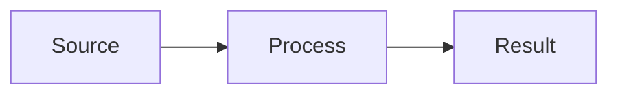

# wiki-markdown

Pages are plain Markdown with Obsidian extensions. Obsidian is optional: everything below stays
readable in any editor and on GitHub; Obsidian adds clickable links, the graph and callout styling.

## Links

| Want                               | Write                                               | Notes                                                     |
|------------------------------------|-----------------------------------------------------|-----------------------------------------------------------|
| link to a page                     | `[[Page Name]]`                                     | filename without `.md`; names are unique                  |
| custom text                        | `[[Page Name\|shown text]]`                         | inside a table cell, put a backslash before the pipe      |
| a heading                          | `[[Page Name#Heading]]`                             |                                                           |
| a system page (repeats per domain) | `[[Project A/wiki/index\|Project A index]]` | path link for `index`, `hot`, `log`, `overview`, `_index` |
| a page, from frontmatter           | `related:` → `  - "[[Page Name]]"`                  | always quoted                                             |
| an external URL                    | `[text](https://…)`                                 | standard Markdown                                         |

Never link to a page's `title:` — link to its **filename**. `wiki-check.py` flags title links.

## Embeds

`![[diagram.png]]` an image from `_attachments/` · `![[Page Name#Section]]` a section of
another page. Use sparingly: an embed is invisible on GitHub.

## Callouts

```markdown
> [!key-insight] The point of this page
> One or two sentences.
```

| Callout                                              | Use for                                            |
|------------------------------------------------------|----------------------------------------------------|
| `> [!key-insight]`                                   | the takeaway a reader must not miss                |
| `> [!gap]`                                           | something unknown or unverified                    |
| `> [!contradiction]`                                 | two sources or pages disagree (put it on **both**) |
| `> [!stale]`                                         | a claim a newer source overtook                    |
| `> [!note]`, `> [!warning]`, `> [!info]`, `> [!tip]` | standard Obsidian callouts                         |

The four custom ones render as plain quotes outside Obsidian unless you add CSS.

## Properties, tags, formatting

- Frontmatter: flat YAML (WIKI.md frontmatter section), lists allowed, no nested objects, dates `YYYY-MM-DD`.
- Tags: in frontmatter `tags:` as `type/concept`, `domain/streaming` (lowercase, hierarchical).
- `==highlight==`, `**bold**`, `*italic*`, `~~strike~~`, footnotes `[^1]`, math `$x$` / `$$…$$`.

## Tables

Column-aligned in the source: pad every cell so the pipes line up and make the separator dashes
span the column. Escape pipes inside wikilinks in cells (`\|`).

## Diagrams

Mermaid renders in Obsidian **and** on GitHub — prefer it over images for flows and structures:

````markdown

````

Quote labels that contain punctuation; use `<br/>` for line breaks; avoid `;` and HTML entities
in labels.

## Never

- Nested YAML objects in frontmatter.
- `[text](page.md)` for internal pages — use `[[…]]` so renames keep working.
- Linking to `index`, `hot`, `overview` by bare name — they exist in every domain; use a path link.
